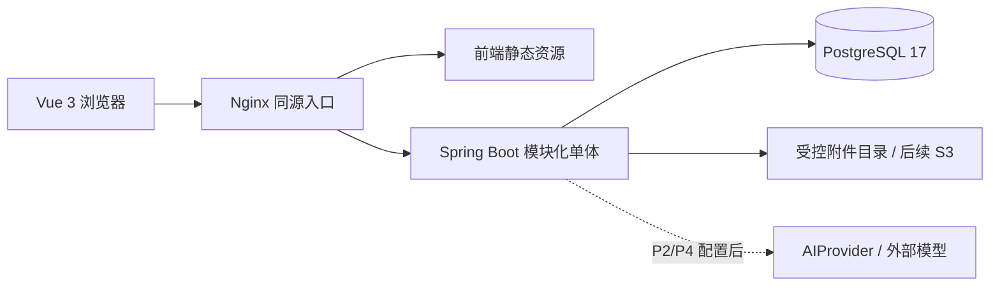

# 架构与工程设计

## 运行拓扑

开发可选 Vite 127.0.0.1:5173 → /api 代理 → 后端 127.0.0.1:8080 → PostgreSQL。Compose 只将 Nginx 绑定 127.0.0.1:8088，数据库和后端留在内部网络；不开放公网。生产 TLS、备份和最小权限配置属于 P6，当前 Compose 不是生产部署。

## 版本与兼容性

- Java 源码 / Docker / CI 固定 Java 21；本机使用 D:/Java21，系统默认 Java 25 不修改。
- Spring Boot 3.5.16，MyBatis Starter 3.0.5，Springdoc 2.8.17；Spring Boot BOM 管理 Flyway、PostgreSQL JDBC、JUnit 等。
- Vue 3.5、Vite 8、TypeScript、Router 4、Pinia 3、Element Plus 2、Tailwind 4；精确版本见 package.json 与 package-lock.json。生产 / CI 使用 Node 24。
- PostgreSQL 17.11；隔离集成测试使用相同主次版本的真实二进制。不得用 H2 替代迁移验证。
- Nginx 作为本地反向代理。依赖使用锁文件；镜像补丁升级需重新运行验收，生产前固定镜像 digest（P6）。

版本依据：[Spring Boot 系统要求](https://docs.spring.io/spring-boot/3.5/system-requirements.html)、[MyBatis 兼容矩阵](https://mybatis.org/spring-boot-starter/mybatis-spring-boot-autoconfigure/)、[Vite 环境要求](https://vite.dev/guide/)。实际制品版本同时经 npm / Maven Central 元数据核对。

## 模块边界

| 模块 | 责任 / 事实源 |
| --- | --- |
| common | 错误体、请求 ID、配置、系统状态；不承载领域逻辑 |
| identity | 用户、认证会话与当前用户；所有私有入口先认证 |
| skill | 技能、归档、分类与搜索 |
| knowledge | 稳定节点、跨技能引用、关系、草案校验与版本事务 |
| path | 目标、路线版本、阶段、用户选择 |
| learning | 任务、时段、笔记、学习状态 |
| assessment | 题目、作答、证据、追加式能力评估 |
| review | 到期复习与解释性调度 |
| ai | Provider、上下文裁剪、任务、对话、预算和成本记录 |
| resource | 资料、附件、校验与带权限下载 |
| analytics | 聚合查询、导入导出边界；不维护另一套学习事实 |

各模块按需使用controller/application/domain/infrastructure；通过应用服务交互，保持明确边界。当前已实现common、identity、skill手动目录及knowledge草案/版本发布，其余责任随阶段加入真实代码，避免空类伪实现。

## 状态与事务

PostgreSQL 是唯一业务事实源。前端 Pinia 仅保存视图状态；刷新重新读取 API。AI 对话不是业务状态。已实现的图谱发布在单个数据库事务内完成；后续确认计划、作答与证据也按事务边界实现。外部模型调用不放在长事务中。P2 发布使用草案 revision / 版本唯一约束与幂等键，锁定当前用户行并检查源指纹；冲突返回 409。关系发布前检查分类环和包含保留外部关系的全用户先修环。

会话认证采用HttpOnly Cookie、CSRF token、同源代理，不把凭据写入localStorage。P1已实现PostgreSQL Spring Session和BCrypt12管理员引导；JSON登录由AuthenticationManager校验，并显式执行会话ID轮换、CSRF轮换和SecurityContextRepository保存。全部私有API按SessionUser UUID限定。依据[Spring Security CSRF](https://docs.spring.io/spring-security/reference/servlet/exploits/csrf.html)与[Spring Session JDBC](https://docs.spring.io/spring-session/reference/configuration/jdbc.html)设计；登录后必须重新获取CSRF。

skill模块承载技能/手动知识树应用服务，CatalogMapper实现目录持久化；节点/关系/位置数据结构明确分离。P2已按草案与版本事务边界拆出knowledge模块。所有用户图写入先锁用户行再校验，保证并发创建相反先修边时至多一条提交。已有版本的图谱必须通过草案修改，底层节点定义保留，不以删除重建覆盖稳定ID和历史。

错误统一 `code/message/details/requestId`，响应回显 X-Request-ID。日志仅写技术上下文和 requestId，不记录 Key / 密码 / 附件正文。健康检查只公开服务存活和就绪状态，不包含连接配置。
