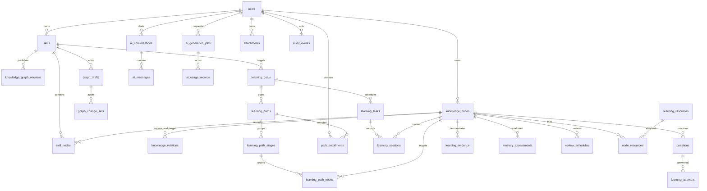

# 数据库设计与迁移

V11新增catalog_imports：owner复合唯一、源目录JSON/hash、DRAFT/CONFIRMED、revision、幂等键、原→新UUID映射和确认时刻。预览与确认皆审计；触发器禁止修改源文档/hash、删除记录或改写确认结果。确认只新建手动知识目录，并保留共享节点映射，不迁移学习事实/能力或自动发布版本。V1–V10不修改。分析只查询既有表，不添加冗余统计事实源。

V10新增13表：review_schedules/review_events/review_cycle_tasks、plan_drafts/plan_draft_limits/plan_draft_items、daily_plans/daily_plan_limits/daily_plan_items/daily_plan_days/plan_confirmation_keys、task_adjustments/task_splits。安排/草案/日指针有revision，用户行锁与事务串行化确认、复测与任务调整。V1–V9不修改。

复习安排每owner/node唯一；周期号仅复测时推进，每周期最多一个任务。原任务、初始证据、周期任务的owner/id/node复合FK保护同节点关联；复测记录每owner/evidence唯一，幂等键每owner唯一。下次时刻为UTC timestamptz，另存原IANA时区。

草案保留候选、排除原因、整项选择及稳定源hash；修改选择不写任务。计划按owner/date递增版本，确认后预算、条目和标题快照不可改。daily_plan_days的复合外键同时约束owner/plan/date，只有当前指针可替换。计划/条目/技能预算、复习事件/周期关联、任务调整/拆分关联有不可变触发器，禁止更新或删除。取消、延期、拆分保留任务及原学习事实，不级联删除。实际SQL迁移是字段与约束的权威来源，流程见P5_DESIGN。

V9新增questions/question_exposures、learning_attempts、attachments/attempt_attachments、ai_conversations/tutor_turns、attempt_reviews、learning_evidence、mastery_assessments/assessment_evidence，共11表；给任务增加owner/id/node复合唯一约束支持同节点FK。作答、复核、证据、评估及关联不可修改或删除。参考答案不进入独立练习DTO；曝光持久化且只升不降，提交时保存自报独立与曝光快照。

Tutor运行记录保存私有上下文和费用快照，与P2共享每日token/货币账本，不创建虚假图谱草案。文件使用独立私有卷，DB保存随机键、归属、校验和与READY/ARCHIVED状态；文件不进Git/数据库。V1–V8不修改。复核与评估始终区分RULE/SELF/REVIEWED_AI来源；REVIEWED_AI需同作答本人成功turn，仍为SELF_REPORTED。

V8新增P3实际关系表：learning_goals；不可变learning_paths/learning_path_stages/learning_path_nodes（版本族、前版引用、标题快照）；path_enrollments/learning_progress；learning_tasks；learning_sessions/learning_session_commands；learning_notes；learning_resources/node_resources。均按owner复合FK隔离。路径修改追加版本，旧选择与记录不删除。选择+路径节点进度、任务笔记使用revision；初次PUT笔记/进度请求revision=0，创建后为1，避免首次并发写覆盖。

每用户最多一个ACTIVE路线选择、一个RUNNING或PAUSED时段，由部分唯一索引保护。时段按服务器分段起点+累计毫秒计时；幂等操作记录不可修改，同键不同操作409。任务与选择/路径节点使用同版本复合FK；应用另校验目标、技能、节点相符。资源仅存http(s)链接、支持归档；不会发起远程抓取。所有V1–V7保持原样，细节见P3_DESIGN.md。

V7新增ai_generation_inputs：当前用户提交的主题/修复上下文、root/parent任务和depth 0–2；每父任务至多一个子任务，复合所有权外键。与任务/token/货币预留同事务写入，仅服务端用于显式有限修复，不通过任务列表返回，不记录日志。已有V1–V6迁移保持不变。

V6新增ai_money_days（owner/UTC日/币种预算）和ai_job_costs（任务价格快照与费用来源）。价格为配置费率，已知用量按BigDecimal计算；未知用量保守占用预留。旧任务不补造费用，跨币种不换算。详见AI_MONEY.md。

状态：本文件包含完整目标模型。P0实际迁移users/audit_events；P1增加Spring Session及手动目录；P2的V4增加草案/版本，V5增加生成任务/token账本。其他目标表仍待实现。数据库为PostgreSQL17，业务实体UUID、时间timestamptz，应用读写UTC，前端按用户时区显示。migration history是实际结构的权威记录。

V5新增ai_generation_jobs和ai_daily_budgets，持久化UTC日token预留/消耗、错误码和候选草案关联。用户行锁串行化预留，结果与草案/审计/结算同事务；计费未知不自动释放。token配额不是货币支出保证，崩溃遗留任务不自动重发，详见AI_JOBS.md。

## P1 实际结构细节

- V2按Spring Session JDBC官方PostgreSQL结构创建spring_session和spring_session_attributes，principal_name扩展为254字符。匿名CSRF会话允许principal为空；认证归属来自服务端序列化SecurityContext。基础设施表采用框架CHAR(36)键，不充当业务实体；会话过期/退出可物理清理，业务审计不删除。
- V3技能与节点均含(owner_id,id)唯一约束；skill_nodes的(owner_id,skill_id)/(owner_id,node_id)复合FK约束跨用户引用，parent_node_id明确指向同技能中父知识节点UUID。每技能同节点仅一个位置；与其他技能的位置独立。
- 节点类型CATEGORY/CONCEPT/PRACTICE；技能/节点ACTIVE或ARCHIVED。归档保留UUID、引用及审计，可恢复。技能移除节点仅删除关联行，必须先移走子节点。
- 关系方向固定先修source→后继target；DB拒绝自引用和重复关系，事务应用层校验全用户先修DAG。所有图写入先锁当前用户行，串行化分类/依赖检测与变更，低并发单用户下优先数据正确性。
- 业务写入同事务追加before/after审计；失败回滚。核心关系未存入JSON；JSON只用于审计快照。没有创建示例技能或掌握度种子。

## 领域 ERD（目标）

## 字段和约束（目标，阶段实施）

除关联表外均包含 id、created_at、updated_at；历史记录只需创建/观察时间，不能静默覆盖。关联表允许复合唯一键，但仍提供稳定 UUID 用于审计。

| 表 / 阶段 | 关键字段、唯一性、索引和删除策略 |
| --- | --- |
| users / P0 | id UUID；email 规范小写且 trim，唯一；password_hash；status ACTIVE/DISABLED；时间戳；不预置用户/密码，P1 安全引导 |
| audit_events / P0 | user_id nullable FK users RESTRICT（系统事件允许空）；entity_type/id、action、before_json/after_json JSONB object、request_id；索引(user_id,created_at)、(entity_type,entity_id,created_at)；触发器禁止 UPDATE/DELETE；运行角色不得禁用触发器 |
| skills / P1 | owner_id FK users、name、description、category、status ACTIVE/ARCHIVED；索引(owner_id,status,updated_at)，搜索按 owner；归档 |
| knowledge_nodes / P1 | owner_id、title、node_type、description、metadata_json object；unique(owner_id,id)，归档；重命名保留 UUID |
| skill_nodes / P1 | owner_id、skill_id、node_id、category_parent_id、display_order；unique(skill_id,node_id)；复合 FK 限制节点/技能同 owner，parent 必须同 skill；排序非负、应用拒绝分类环 |
| knowledge_relations / P1 | owner_id、source_node_id、target_node_id、relation_type；unique(owner_id,source,target,type)，source!=target，复合 FK 所有权；索引(target,type)；PREREQUISITE_OF 为 source先修 → target后继，完整 DAG 校验 |
| knowledge_graph_versions / P2 | owner_id、skill_id、version_number、published_at、snapshot_json；unique(skill_id,version_number)，发布后不可变 |
| graph_drafts / P2 | owner_id、skill_id、base_version_id、draft_json、schema_version、revision>=0、status EDITING/VALIDATED/PUBLISHED；引用同技能，更新 where revision；发布后只读 |
| graph_change_sets / P2 | owner_id、draft_id、actor_type USER/AI、changes_json、validation_json、节点映射；追加记录，不级联删除 |
| learning_goals / P3 | user_id、skill_id、title、target_description、deadline、priority、status；索引(user_id,status,deadline)，归档 |
| learning_paths / P3 | owner_id、skill_id、goal_id、version_number、title、status；unique(skill_id,id,version_number)，生效后修改生成新版本 |
| learning_path_stages / P3 | owner_id、path_id、title、display_order>=0；索引(path_id,display_order) |
| learning_path_nodes / P3 | owner_id、stage_id、node_id、display_order、target_level 0..5、required；unique(stage_id,node_id)，节点不能跨 owner |
| path_enrollments / P3 | user_id、path_id、status、started_at、completed_at；unique(user_id,path_id)，保留历史 |
| learning_tasks / P3 | user_id、goal_id/node_id/path_id nullable、title、planned_minutes>0、due_date、status TODO/DOING/DONE/DEFERRED/CANCELLED；索引(user_id,due_date,status)；延期保存审计 |
| learning_sessions / P3 | user_id、task_id/node_id、started_at、ended_at、duration_seconds>=0、activity_type、note、pause_state；end>=start，索引(user_id,started_at)、(node_id,started_at)；部分唯一索引限制一个活动计时 |
| questions / P4 | owner_id、node_id、prompt、question_type、answer_key_ref（服务端隔离）；索引(owner_id,node_id)；答案不随题目发给独立练习 UI |
| learning_attempts / P4 | user_id、question_id、submitted_content、result、hint_count>=0、reviewer_type、status；先保存作答再异步批改；索引(user_id,question_id,created_at) |
| learning_evidence / P4 | user_id、node_id、evidence_type、source_type/source_id、verified_status、observed_at、revision_of nullable；按类型验证来源归属；撤销追加记录；索引(user_id,node_id,observed_at) |
| mastery_assessments / P4 | user_id、node_id、level 0..5、confidence LOW/MEDIUM/HIGH、basis_json、assessed_at、assessor_type SELF/RULE/REVIEWED_AI；证据关联表 assessment_evidence；追加，最新按时间视图 |
| review_schedules / P5 | user_id、node_id、next_review_at、interval_days>=1、state_json、reason、revision；unique(user_id,node_id)，索引(user_id,next_review_at)；复测结果独立保留 |
| plan_drafts / P5 | user_id、plan_date、budget_minutes、draft_json、revision、status DRAFT/CONFIRMED/CANCELLED；确认事务与幂等键，不修改未选任务 |
| learning_resources / P3 | owner_id、title、resource_type、url、metadata_json；只允许 http(s) URL，不从服务端随意抓取 |
| node_resources / P3 | owner_id、node_id、resource_id、relevance；unique(node_id,resource_id)，同 owner 复合 FK |
| ai_conversations / P4 | user_id、context_type/context_id、title；应用服务验证上下文归属，不允许多态 ID 绕过鉴权 |
| ai_messages / P4 | owner_id、conversation_id、role、content_json、created_at；索引(conversation_id,created_at)，同 owner |
| ai_generation_jobs / P2 | user_id、job_type、status、provider/model、prompt_version/schema_version、output_ref、error_code、idempotency_key；unique(user_id,idempotency_key)，索引(user_id,status,created_at) |
| ai_usage_records / P2 | user_id、job_id nullable、provider/model、input_tokens/output_tokens>=0、estimated_cost NUMERIC(16,8)>=0、currency、usage_source ESTIMATED/REPORTED；追加；索引(user_id,created_at) |
| attachments / P4 | owner_id、storage_key unique、mime_type、size_bytes>0、checksum SHA256、status QUARANTINED/READY/REJECTED；文件名不作存储路径，先校验后 READY，索引(owner_id,status) |
| idempotency_records / P2 | user_id、operation、key、request_hash、response_ref、expires_at；unique(user_id,operation,key)，重复键不同请求返回409 |

外键一般 RESTRICT，避免级联毁掉证据/历史。用户归档不删除数据。复合 FK (owner_id,id) 是数据库隔离第二道约束，第一道始终是服务端按认证用户过滤。多态来源通过应用验证并保存稳定引用；高价值来源在实施阶段优先显式外键。

## Flyway 门禁

P2新增V4：graph_drafts(owner_id,skill_id,draft_json,revision,base_hash,status)、knowledge_graph_versions(每技能版本号唯一，draft_id唯一，snapshot_json)、graph_publish_keys(用户/键唯一)。复合FK隔离所有权，版本触发器拒绝UPDATE/DELETE。草案保存和发布复用audit_events记录变更，含前后revision与文档；未新增重复审计事实源。源指纹只包含技能/节点/位置/关系，不包含草案、会话或审计。连接初始化设置UTC，避免不同JVM时区使时间序列化导致指纹漂移。V1–V3不修改。

迁移路径 `backend/src/main/resources/db/migration`。P0 `V1__identity_and_audit_baseline.sql`：无个人数据、无默认账号，建身份和审计表/约束。`baseline-on-migrate=false`，`clean-disabled=true`，启动 validate + migrate，禁止失败后绕过校验。测试必须验证空库迁移、重复启动幂等、真实 PG 约束和应用重启后持久化。

P6 备份使用 pg_dump 自定义格式，数据库与附件清单共同校验；恢复只在隔离环境演练。导入先 schema/归属/引用校验预览，用户确认后事务写入，不自动 DROP、TRUNCATE 或覆盖原记录。
